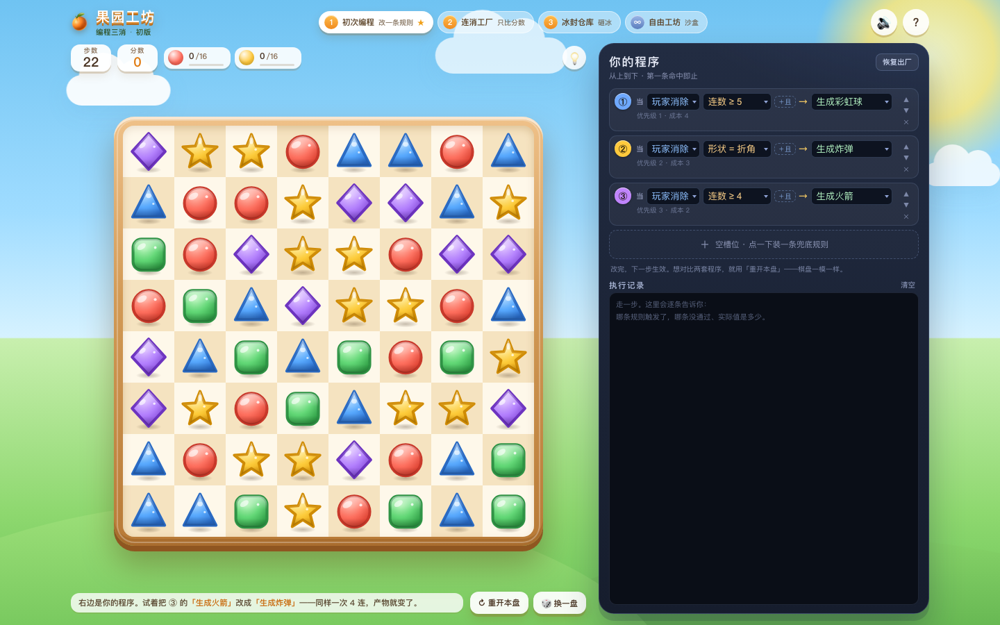

# 果园工坊 · 编程三消

> 可玩版：把 `basic/` 的手感接上一张**玩家可编辑的规则表**。
> 先做出来让人感受“同一双手、同一个棋盘，程序变了结果就变了”，
> 具体要加哪些规则、要不要预算、怎么解锁，等你玩过再定。
> 本次新增第 5 个页签 **三分钟果园**：固定 3 分钟，时间到就收工——比同一段时间里谁消得多、谁的程序配得好。

引擎测试 30/30 通过。零依赖、无构建，静态 HTML/CSS/JS。

> 线上路径：个人站 `/match3-program/`（源码同步在 `personal-site` 仓库；发布约定见工作区 `AGENTS.md`）。



---

## 跑起来

```bash
cd program
./dev.sh          # 默认 8170；已在跑会直接打开
./dev.sh 8180     # 换一个端口
```

没有 npm、没有打包。也可以直接在这个目录起任意静态服务器：

```bash
python3 -m http.server 8170 --bind 127.0.0.1
```

---

## 三分钟感受路径

1. **第 1 关**，照常滑一步。看棋盘上带 **①/②/③** 小角标的特殊棋子，再到右下角执行记录里找它的出处。
2. 点右边 **③ 连数≥4 → 火箭** 的动作，改成 **炸弹**。再走一步；用 **「重开本盘」** 把同一个棋盘重来，对比“同样的 4 连，出来的是不是不一样”。
3. 去 **第 2 关**。先不抄配方，用出厂程序玩到输；再点 **「📋 抄一份本关推荐程序」**，看“连消”规则怎么把雪球滚起来。
4. **第 3 关** 看“每步开始”规则：它和“玩家消除”规则**不是同一条 if 链**，不会互相挡住。
5. **第 4 关** 是沙盒：没有目标、99 步，专门用来试规则。
6. 去 **第 5 个页签「三分钟果园」**。第一步开始计时，3:00 倒数到 0 就收工，**消除不会加时**。先打一班看分数和消除格数；想比程序就点「去改程序」，改完再点「重开本盘」——同一块棋盘直接比。

> 改规则是**下一步生效**，当前这一步已经结算完了。想严格 A/B 对比就用「重开本盘」——种子不变，棋盘一模一样。

---

## 规则模型

右边是 4 个槽位，从上往下检查，**第一条满足的生效，后面的直接跳过**——就是 `if / elif / else`。

### 触发时机

| 触发 | 什么时候检查 | 说明 |
| --- | --- | --- |
| 玩家消除 | 玩家交换 / 点道具产生的**第 1 层**匹配 | 每个匹配组检查一次 |
| 连消 | 第 **2 层及以后**的匹配 | 每个匹配组检查一次 |
| 每步开始 | 扣步之后、消除之前 | 每次有效操作触发一次；**不会挡住**玩家消除规则 |

不同触发时机是**分开检查**的：一条“每步开始”规则即使写在最上面，也不会让下面的“玩家消除”规则失效。这是刻意的，否则“每步开始 + 加分”这种规则会变成万能堵头。

### 条件

| 条件 | 含义 |
| --- | --- |
| 连数 ≥3 / 4 / 5 | **最长直线**的格数，不是这一组的格子总数 |
| 形状 = 直线 / 折角 | 折角包含 L 和 T；暂不细分 |
| 方向 = 横向 / 纵向 | 只对直线有意义 |
| 颜色 = 红/黄/绿/蓝/紫 | 匹配组的颜色 |
| 连消 ≥2 / 3 层 | 当前链的层数 |
| 剩余步数 ≤5 / 8 | 在**扣完这一步之后**判断，所以“最后 5 步”包含当前这步 |

> 连数用最长直线是有意的：一个 5 格的 L 形，最长直线只有 3。这样「连数≥5」不会把折角抢走，②折角规则才有机会命中。执行记录里的“实际 3”就是这条语义。

### 动作

| 动作 | 效果 |
| --- | --- |
| 火箭 | 生成横/竖火箭，方向随匹配方向 |
| 炸弹 | 生成 3×3 炸弹 |
| 彩虹球 | 生成彩虹球；点它清场上最多的一种颜色，和普通棋子交换则清对方颜色 |
| +150 分 | 直接加分，不生成棋子 |
| 随机变炸弹 | 随机一个普通格变成炸弹；不会落在触发它的那一组消除格上 |

“每步开始”只开放 **随机变炸弹 / +150 分** 两个动作；“玩家消除 / 连消”五个都开放。界面会按触发时机过滤选项。

### 出厂程序

```
① 玩家消除 · 连数≥5        → 彩虹球
② 玩家消除 · 形状=折角      → 炸弹
③ 玩家消除 · 连数≥4        → 火箭
④ （空）
```

这就是传统三消里硬编码的那张表，只是现在摊开给你改。成本显示为 4 / 3 / 2 / 0，仅作参考——**首版没有硬预算**，4 个槽位就是唯一的约束。

---

## 关卡

| # | 关卡 | 目标 | 步数 | 首版情况 |
| --- | --- | --- | --- | --- |
| 1 | 初次编程 | 红 ×16 + 黄 ×16 | 22 | 出厂程序能过；适合改③看差异 |
| 2 | 连消工厂 | 4500 分 | 18 | 出厂程序 4/8 胜；抄“连消”配方 8/8 胜（8 个种子） |
| 3 | 冰封仓库 | 蓝 ×14 + 砸开 48 块冰 | 20 | 出厂程序 4/8 胜；抄“每步开始”配方 8/8 胜（8 个种子） |
| 4 | 自由工坊 | 无 | 99 | 沙盒，不判胜负 |
| 5 | 三分钟果园 | 3 分钟比分 + 比消除 | 棋盘持续补 | 固定 3:00，时间到收工；本机策略榜 |

第 2、3 关的“抄一份”按钮会载入一套推荐程序；不是隐藏答案，只是把“逻辑 > 数值”的差距演示出来。数值是第一版，等你实际玩完再调。

### 三分钟果园（固定 3 分钟）

- **3:00 起跑，3:00 收工**：第一步有效操作才开始计时；结算动画、帮助/结算弹窗、切到后台时**暂停**，不偷偷扣时间。**消除不会加时**——3 分钟是终点线，不是起跑线。
- **两个数一起看**：`分数` 看这一班打得多高，`消除格数` 看这双手消得多勤。结算给评级（S/A/B/C/D）、每分钟得分、最高连消。
- **比程序**：结算页的「同盘重打」用同一个种子重开；想换程序对比，就「去改程序」后再点「重开本盘」——同一块棋盘、同样的 3 分钟，两套规则表直接比分数和格数。
- **本机策略榜**：每套程序（按规则指纹）留最好的一班，结算页列出前 3 + 本班；最佳分数和最佳格数分开记，都存在本地。
- **可解释**：执行记录多一行 `🧹 消除 12 格 · 匹配 4 组 · 特殊棋 ×1`，这一手消了多少一眼可见。
- 评级线在 `js/engine.js` 的 `ENDLESS.grades`，调阈值不用碰 UI。

---

## 执行记录怎么读

- **第 N 步 · +得分 · 连消 ×N**：这一步的总账。
- **每组匹配**：颜色、连数、方向/折角。
- **`① 触发 → 生成火箭`**：这条规则命中了；特殊棋子角标就是出处。
- **`② 连数 ≥ 5（实际 3）`**：这条没通过，以及实际值。
- **`都没命中 · ...`**：这个触发时机下所有启用的规则都没通过。
- **`每步开始`**：回合规则单独一段，排在最上面（最新在前）。
- **`🧹 消除 12 格`**：无尽模式专属，后面写匹配组数 / 特殊棋 / 破冰。
- 如果这一步重排了棋盘，会多一行“棋盘重排”。

日志是最重要的教学设计：它不只说“成了”，而是说“为什么没成”。如果玩家不看它，这版就只剩一个规则编辑器；所以第一版特意把日志放在棋盘旁边，而不是折叠面板里。

---

## 代码结构

```
program/
  index.html            页面骨架 + 五色宝石 SVG
  css/base.css          从 basic/ 复用的棋盘/棋子/弹窗手感
  css/style.css         本模式的布局与暗色程序面板
  js/engine.js          规则引擎（纯逻辑，无 DOM）
  js/view.js            棋盘渲染 + 步骤流动画
  js/app.js             关卡、编辑器、日志、存档、输入
  js/audio.js           音效（复用 basic/，加了规则/冰/金币）
  test/engine.test.js   30 项引擎测试
  dev.sh                本地静态服务
```

引擎把一整步算完，输出 `steps` 步骤流；view 只负责回放。所以逻辑可以单独 `require` 测试，动画不会反过来影响结算。

---

## 测试

```bash
cd program
node test/engine.test.js
```

当前覆盖：规则顺序、三个触发时机、条件语义（最长直线/颜色/方向/层数/低步数）、五种动作、随机炸弹落点、冰面、道具组合、回合规则、确定性、洗牌不留下假匹配、星级/目标、无尽统计与评级、机器人跑关。

---

## 已知边界（首版故意留的）

- **没有硬预算**：成本只显示，不限制。先把“改规则 → 看结果”的体感做出来，再决定 RAM/CPU 怎么收。
- **五关全开**：没有按进度解锁词条。设计文档里的“语言即成长”是下一步，不是这一版。
- **三分钟果园没有联网排行榜 / 局外成长 / 阶梯难度**：先验证“固定 3 分钟 + 比分数/格数 + 本机策略榜”的竞争感，再决定要不要做账号榜、每日班次或难度波次。
- **策略榜按规则指纹区分**：条件 / 动作 / 顺序任一处不同就算一套新程序；分数相同再比消除格数。榜最多留 12 套，超出按成绩裁掉。
- **规则槽固定 4 条**：够表达出厂表 + 一条实验规则；更多槽位会把面板变成表格。
- **特殊棋子的角标不追溯**：已经生成的棋子保留生成时的规则号；改顺序/改规则不会改写旧棋子。这是有意的，棋子是“历史产物”。
- **折角不细分 L/T**：条件只有“折角”，日志里会写形状。
- **移动端**：窄屏下面板在棋盘下方，执行记录会比较小；桌面是主体验。
- **没有撤销/预览**：滑动即结算，和 basic 一致。
- **每步开始只结算一次**：不会在同一步里循环触发。
- **没有局内语句卡掉落、没有解锁树、没有发布/分享**。

---

## 想加东西时改哪里

**加一个条件**（三处引擎 + 一处 UI）：

1. `js/engine.js` 的 `CONDS` 加词条/成本；
2. 同文件 `CONDS_FOR` 决定哪些触发可用；
3. 同文件 `condFails()` 加判断和“实际值”文案；
4. `js/app.js` 的 `COND_CAT` / `pickSecondCond()` 决定它能不能当第二条件；
5. `test/engine.test.js` 加断言。

**加一个动作**：

1. `ACTIONS` / `ACTIONS_FOR`；
2. `applyAction()`（匹配内）和/或 `runTurnAction()`（回合）；
3. `view.js` 加视觉/音效（如果需要）；
4. 测试。

**加一个触发时机**：

1. `TRIGGERS` / `CONDS_FOR` / `ACTIONS_FOR`；
2. 找到对应结算点调用 `evalRules()`；
3. app 的触发下拉会自动出现；
4. 测试。

**加一关**：`LEVELS` 里加对象（`goals`、`moves`、`ice`、`tip`、可选 `rec`），`RECIPES` 里加配方。UI 的关卡页签会自动生成；要做限时，再加 `endless` 标记和 app 里的倒计时分支。

`basic/` 是手感基准，保持不动；`program/` 独立演进。

---

## 这版想验证的问题

1. 玩家第一次看到“规则没命中”的日志，会不会产生“哦，原来是这样”的瞬间？
2. 玩家会不会主动改一条规则、再走一步、回头看日志？还是只把它当普通三消？
3. “重开本盘 + 换程序”的 A/B 对比，玩家会不会用？
4. “每步开始”这种不挡消除的触发，是太强、太弱，还是刚好？
5. 4 个槽位够不够？什么时候会想要第 5 条？
6. 三分钟果园里，玩家会不会为了分数/格数去改程序？「改完程序 → 重开本盘」的 A/B 对比有没有人用？

这些答案会决定下一步是加预算、加词条、做解锁，还是先把日志/规则表的手感再磨一轮。
